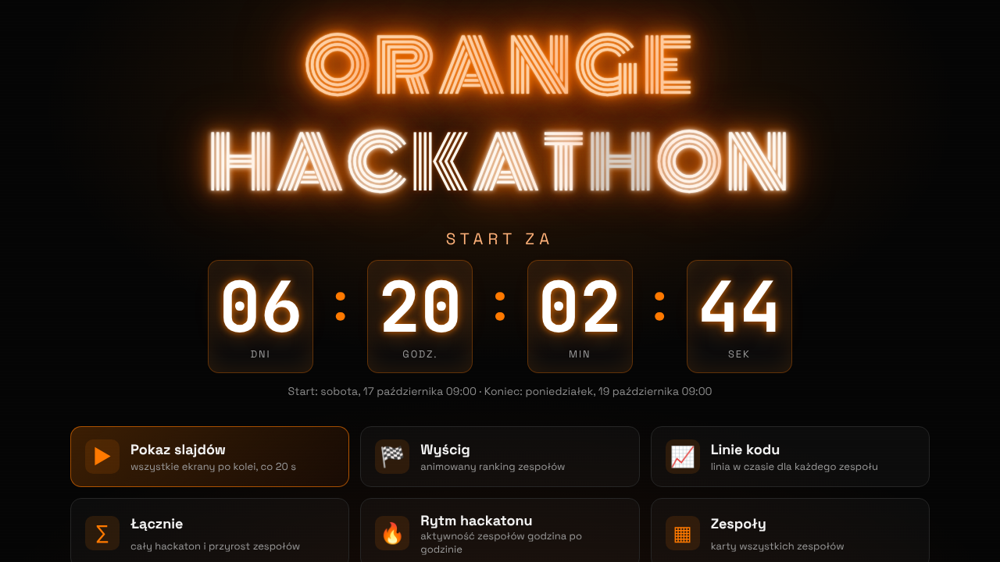

# Orange Hackathon – dashboard dynamiki zespołów



Lokalna wersja aplikacji (etap 1). Kolektor co 10 minut pobiera z GitHuba commity i pull requesty
wszystkich repozytoriów organizacji, a dashboard pokazuje je na żywo na ekranach w sali.

Wymagania: **Python 3.11+** (bez dodatkowych bibliotek; na Windows dodatkowo `pip install tzdata`) albo **Docker**.

## Dla osób oceniających: uruchomienie w 3 krokach

```bash
git clone <adres-tego-repo> && cd <nazwa-repo>
cp .env.example .env      # wpisz GITHUB_TOKEN i GITHUB_ORG (opis niżej)
python main.py --once && python main.py
```

Potem otwórz http://localhost:8080. Bez tokenu możesz od razu zobaczyć aplikację na danych
testowych: `python main.py --demo`. Zrzuty wszystkich ekranów są w [docs/screens](docs/screens).

## Szybki start bez tokenu (tryb demo)

```bash
python main.py --demo
```

Otwórz http://localhost:8080 (strona startowa). Demo generuje 30 godzin historii 25 zespołów i co 20 sekund dodaje nową aktywność.

## Uruchomienie z prawdziwymi danymi

1. Utwórz token fine-grained PAT dla organizacji hackatonu (GitHub → Settings → Developer settings →
   Fine-grained tokens): *Resource owner* = organizacja, *Repository access* = All repositories,
   uprawnienia tylko do odczytu: **Contents**, **Pull requests**, **Metadata**.
   Jeśli organizacja wymaga zatwierdzania tokenów, admin musi go zaakceptować.
2. `cp .env.example .env` i uzupełnij `GITHUB_TOKEN`, `GITHUB_ORG`, `HACKATHON_START`, `HACKATHON_END`.
3. Sprawdź jedną synchronizację: `python main.py --once` (kod wyjścia 0 = sukces).
4. Uruchom całość: `python main.py` albo `docker compose up --build`.

Każde repo w organizacji to jeden zespół. Repozytoria są wykrywane automatycznie przy każdym przebiegu;
`REPO_PREFIX` lub `REPO_TOPIC` w `.env` zawężają wybór, a archiwalne repo są pomijane.

Licznik czasu na górze dashboardu liczy się sam z `HACKATHON_START` i `HACKATHON_END`
(data, godzina i strefa czasowa, np. `2026-11-16T10:00:00+01:00`): przed startem pokazuje
czas do startu, w trakcie czas do końca. Te same daty wyznaczają zakres danych na wykresach.

## Nazwy biznesowe zespołów

Skopiuj `teams.example.json` do `teams.json` i wpisz nazwy. Zmiany są widoczne bez restartu
(najpóźniej po 5 s). Można też ukryć repo (`"hidden": true`) i ustawić kolor zespołu.

```json
{ "team-01": "Nocne Marki", "repo-organizatorow": { "hidden": true } }
```

## Strona startowa

Pod adresem `http://localhost:8080/` jest strona startowa z neonowym logo **Orange Hackathon**
w kolorach Orange (pomarańczowa i biała rura neonowa, litery G i K co jakiś czas „łapią styk”,
a cały szyld czasem przygasa). Pod logo jest licznik: przed startem odlicza czas **do startu**
(dni, godziny, minuty, sekundy), w trakcie czas **do końca** z paskiem postępu, a po zakończeniu
pokazuje podziękowanie. Daty pochodzą z `HACKATHON_START` i `HACKATHON_END`. Niżej są linki do pokazu
slajdów i do każdego z 5 ekranów dashboardu. Kliknięcie logo na dashboardzie wraca na stronę startową.
Logo i fonty są dołączone lokalnie, więc wyglądają tak samo bez internetu.

## Ekrany dashboardu

Każdy ekran ma u góry stały pasek: licznik do końca hackatonu z paskiem postępu, godzinę ostatnich
danych z GitHuba i 6 liczników całego wydarzenia (commity, linie kodu netto, scalone PR, commity
w ostatniej godzinie, aktywne zespoły, osoby kodujące teraz). Po prawej zawsze widać najgorętszy
zespół godziny i listę wydarzeń na żywo, a na dole przewija się pasek z rankingiem.
Kamienie milowe i awanse w rankingu wyskakują na środku ekranu.

| Nr | Ekran (`view`) | Co reprezentuje | Na co patrzeć |
| --- | --- | --- | --- |
| 1 | Wyścig (`race`) | Ranking zespołów jako poziome słupki. Po wejściu na ekran odtwarza w kilkanaście sekund cały przebieg hackatonu od startu do teraz, słupki wyprzedzają się na żywo, potem pokazuje stan bieżący. Przy rotacji ranking zmienia się na zmianę: liczba commitów, potem linie kodu. | Kto prowadzi i kiedy następowały wyprzedzenia. |
| 2 | Linie kodu (`loc`) | Osobna linia dla każdego zespołu: skumulowana liczba linii kodu netto w czasie, z nazwą i aktualną wartością na końcu linii. Grubsze linie mają zespoły z czołowej szóstki. | Tempo przyrostu kodu każdego zespołu i momenty dużych skoków. |
| 3 | Łącznie (`total`) | Biała linia to suma linii kodu wszystkich zespołów w czasie. Kolorowe słupki pokazują, ile linii dopisał każdy zespół w danym przedziale (kolor zespołu jak na pozostałych ekranach). | Dynamika całego wydarzenia: przyspieszenia, nocny spadek, finałowy zryw. |
| 4 | Rytm hackatonu (`heat`) | Heatmapa: wiersz to zespół, kolumna to godzina hackatonu, kolor to liczba commitów w tej godzinie (od ciemnego przez niebieski do różowego i żółtego). | Kto pracuje w nocy, kiedy są przerwy, które zespoły mają równe tempo. |
| 5 | Zespoły (`grid`) | Karta każdego zespołu: miejsce i zmiana pozycji w ostatniej godzinie, commity, linie kodu, scalone PR, wykres tempa z ostatnich 6 godzin, commity w ostatniej godzinie, strzałka momentum (zmiana względem poprzedniej godziny) i liczba osób kodujących. | Szybki przegląd wszystkich zespołów naraz. |

## Wybór ekranu i rotacja jak slajdy (parametry URL)

**Bez parametrów dashboard (`/dashboard.html`) pokazuje jeden ekran i się nie zmienia.** Który ekran, wybierasz
parametrem `view`; rotację jak w pokazie slajdów włącza dopiero parametr `slide`.

| Parametr | Domyślnie | Znaczenie |
| --- | --- | --- |
| `view` | `race` | Ekran do wyświetlenia: `race`, `loc`, `total`, `heat`, `grid`. Bez `slide` stoi na nim na stałe; ze `slide` pokaz od niego startuje. |
| `slide` | brak (rotacja wyłączona) | Włącza rotację: czas wyświetlania jednego ekranu w sekundach (minimum 5). |
| `views` | wszystkie | Działa ze `slide`: które ekrany rotują i w jakiej kolejności, np. `views=race,total,grid`. |
| `refresh` | `30` | Co ile sekund przeglądarka pobiera nowe dane z serwera. |

**Rekomendowany start rotacji: `slide=20`.** Przy 20 sekundach odtworzenie wyścigu trwa około 14 s,
a przez resztę widać wynik końcowy; pełny cykl 5 ekranów trwa 100 s. Krótszy czas (10–15 s)
sprawdza się na ekranie przy wejściu, gdzie ludzie przechodzą obok; dłuższy (30–40 s) na dużym
ekranie, przed którym się siedzi i czyta szczegóły.

Przykłady:

```
http://localhost:8080/dashboard.html                      Wyścig, na stałe
http://localhost:8080/dashboard.html?view=grid            karty zespołów, na stałe
http://localhost:8080/dashboard.html?slide=20             wszystkie ekrany po kolei, 20 s każdy
http://localhost:8080/dashboard.html?slide=15&views=race,total,grid   tylko 3 ekrany, 15 s
```

Klawiatura: `1`–`5` wybiera ekran i zatrzymuje rotację, spacja włącza lub wyłącza rotację (20 s, gdy brak `slide`),
`F` przełącza pełny ekran. Biblioteka wykresów (ECharts) jest dołączona lokalnie, więc dashboard
działa także przy słabym internecie w sali (fonty mają systemowy zapas).

## Metryki

| Metryka | Definicja |
| --- | --- |
| Commity | commity bez merge ze wszystkich gałęzi, bez duplikatów po SHA |
| Linie kodu | dodane minus usunięte, tylko domyślna gałąź, bez merge, bez plików generowanych (lockfile, `node_modules`, `dist`, obrazy…) i bez commitów odstających (> `OUTLIER_LINES`) |
| PR | otwarte, scalone, zamknięte bez scalenia; mediana czasu do scalenia |
| Tempo | commity i linie w ostatniej godzinie, liczba osób kodujących w ostatniej godzinie |
| Momentum | zmiana liczby commitów względem poprzedniej godziny |
| Wydarzenia | otwarcia i scalenia PR, awanse w rankingu, kamienie milowe (pierwszy PR, 50/100/250/500 commitów, 1 000 do 100 000 linii) |

Autorzy są zapisywani tylko jako skrót (hash), bez loginów i e-maili; dashboard pokazuje wyłącznie zespoły.

## Struktura

```
main.py            uruchomienie: --demo, --once, --serve-only, --collect-only
app/config.py      konfiguracja z .env
app/github.py      klient GitHub GraphQL + REST, ponawianie i kontrola limitu API
app/collector.py   pobieranie przyrostowe (tylko zmienione gałęzie), filtr plików generowanych
app/db.py          SQLite; schemat zgodny z planowanymi tabelami BigQuery, zapis idempotentny
app/metrics.py     agregaty dla dashboardu
app/server.py      API /api/dashboard i pliki statyczne
app/demo.py        generator danych testowych
static/            strona startowa (index.html, neon.css) i dashboard (dashboard.html, ECharts)
tests/             testy bez sieci: python -m unittest discover -s tests
```

## Droga do GCP (etap 2)

`collector.py` uruchamiany z `--once` to gotowy Cloud Run job wywoływany przez Cloud Scheduler.
Do podmiany zostaje `db.py` (adapter BigQuery z `MERGE`) oraz publikacja wyniku `compute_dashboard`
do Firestore lub Cloud Storage; frontend potrzebuje tylko innego adresu `/api/dashboard`.
